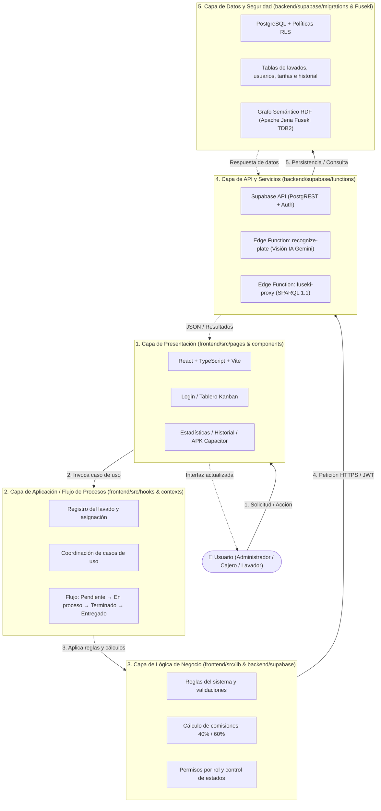

# Arquitectura en 5 Capas y Trazabilidad del Sistema

El sistema **Autolavado Express El Chorro** está estructurado bajo una **arquitectura desacoplada en 5 capas**, integrando desarrollo web/móvil híbrido, Backend as a Service (BaaS) y Web Semántica.

## Diagrama de Arquitectura y Flujo General

---

## Trazabilidad por Capas y Ubicación en el Repositorio

| Capa | Responsabilidad Principal | Componentes y Funcionalidades | Ubicación en el Proyecto |
| :--- | :--- | :--- | :--- |
| **1. Capa de Presentación** | Interfaz gráfica web y móvil con la que interactúa el usuario final. | • Interfaz en **React + TypeScript + Tailwind** • Vistas de Login, Tablero Kanban, Estadísticas e Historial • Empaquetado móvil Android (**Capacitor APK**) y despliegue en **Vercel** | `frontend/src/pages/` `frontend/src/components/` `frontend/android/` |
| **2. Capa de Aplicación / Flujo de Procesos** | Orquestación de los casos de uso y transición operativa del servicio. | • Registro de vehículos y asignación de lavador (QR / manual) • Seguimiento del trabajo en tiempo real • Máquina de estados: `Pendiente` → `En proceso` → `Terminado` → `Entregado` | `frontend/src/hooks/` `frontend/src/contexts/` |
| **3. Capa de Lógica de Negocio** | Aplicación de reglas financieras, validaciones y control de acceso. | • Cálculo automático de reparto (**40% lavador / 60% negocio**) • Cálculo de totales, tarifas por tipo de vehículo e indicadores KPI • Validación de transiciones de estado y permisos por rol (`admin`, `staff`) | `frontend/src/lib/` `backend/supabase/migrations/` *(funciones RPC)* |
| **4. Capa de API y Servicios** | Comunicación segura mediante protocolos HTTP/REST y servicios externos. | • **Supabase API (PostgREST)** para operaciones CRUD y **Supabase Auth** (JWT) • **Edge Function `recognize-plate`**: integración con **Gemini Vision IA** para lectura de placas • **Edge Function `fuseki-proxy`**: puente SPARQL hacia el grafo semántico | `frontend/src/integrations/supabase/` `backend/supabase/functions/recognize-plate/` `backend/supabase/functions/fuseki-proxy/` |
| **5. Capa de Datos y Seguridad** | Almacenamiento persistente, integridad referencial y aislamiento de datos. | • Base de datos relacional **PostgreSQL** (`wash_jobs`, `washers`, `service_prices`, `businesses`, `wash_job_status_history`) • Seguridad a nivel de fila (**Row-Level Security - RLS**) por negocio • Base de conocimiento **RDF / TDB2** en **Apache Jena Fuseki** | `backend/supabase/migrations/*.sql` `autolavado_semantico.ttl` |

---

## Flujo General de Trazabilidad

* **Flujo de Ejecución (Ida):**
  `Usuario` $\rightarrow$ `1. Presentación` $\rightarrow$ `2. Aplicación / Procesos` $\rightarrow$ `3. Lógica de Negocio` $\rightarrow$ `4. API y Servicios` $\rightarrow$ `5. Datos y Seguridad`
* **Flujo de Respuesta (Retorno):**
  `5. Datos y Seguridad` $\rightarrow$ `4. API y Servicios` $\rightarrow$ `1. Presentación` $\rightarrow$ `Usuario`
